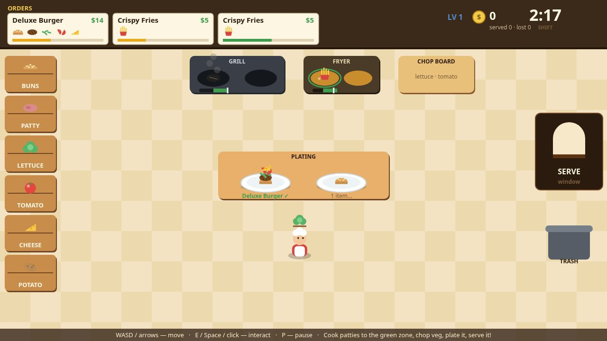

# Sizzle & Serve — a tiny kitchen rush

[](https://make.fun/bounty/best-cooking-game-20261125-0137?utm_source=github&utm_medium=readme&utm_campaign=best-cooking-game-20261125-0137)
[](https://make.fun/bounty/best-cooking-game-20261125-0137/leaderboard?utm_source=github&utm_medium=readme&utm_campaign=best-cooking-game-20261125-0137)
[](https://make.fun/bounty/best-cooking-game-20261125-0137?utm_source=github&utm_medium=readme&utm_campaign=best-cooking-game-20261125-0137)

**Sizzle & Serve** is a fast top-down kitchen-rush game: run the chef, take orders, grill
patties to the green zone, chop veg, plate dishes and serve them before the customers walk
out. One 3-minute shift, three levels of rising pressure, tips, combos and stars.

Play it: https://darendrarp.github.io/best-cooking-game-20261125/ (GitHub Pages, free)



## How to play

- **Move** — WASD or arrow keys (or click where to go).
- **Interact** — E, Space, or click a station: grab an ingredient from a crate, put a patty
  on the grill, drop a potato in the fryer, chop on the board (3 chops), add to a plate,
  pick a plate up, serve it at the window, or bin a mistake in the trash.
- **Cook to the green zone** — a patty is perfect at 4–8 s on the grill, fries at 3–7 s in
  the fryer. Leave them longer and they burn; burnt food goes in the trash.
- **Serve fast, earn tips** — an order pays its price plus up to 50% the sooner it is
  served. Three serves in a row without losing an order adds a $3 combo bonus.
- **The shift** — 3 minutes. Orders arrive faster and customers get less patient as the
  level rises (Lv 1 → 2 → 3). Earn 45 / 85 / 130 coins for 1 / 2 / 3 stars.

## The menu

| Dish | Price | Needs |
| --- | --- | --- |
| Classic Burger | $8 | bun, patty, lettuce (chopped) |
| Cheese Burger | $9 | bun, patty, cheese |
| Deluxe Burger | $14 | bun, patty, lettuce (chopped), tomato (chopped), cheese |
| Garden Salad | $7 | lettuce (chopped), tomato (chopped), cheese |
| Crispy Fries | $5 | fries |

## Run it locally

```sh
node serve.ts            # serves game/ on http://localhost:8080
```

No build step, no dependencies, no network: plain ES modules and a canvas, with
synthesised WebAudio sound effects (no audio files). `?shot=play|start|serve|end&seed=1`
replays the scripted scenes the screenshots were taken from — every screenshot in
`screenshots/` is a real capture of the game running.

## Layout

```
game/            the game: index.html + src/ (one module per job)
  src/config.js  tuning: timings, prices, layout, stations
  src/recipes.js the five dishes
  src/world.js   the rules: orders, cooking, chopping, plating, serving, scoring
  src/render.js  all drawing (canvas, no assets)
  src/input.js   keyboard + mouse
  src/sound.js   synthesised effects
  src/shots.js   the scripted chef behind the screenshots
  src/main.js    boot + the game loop
main.ts          the make.fun hand-in: copies game/ + screenshots/ and writes dossier.json
serve.ts         the local dev server
shots.json       the four screenshot scenes and their queries
screenshots/     the four entry screenshots (real captures)
vendor/          the vendored make.fun library, unchanged from the kit
```

## Entry

Built in-session for the [best-cooking-game-20261125-0137](https://make.fun/bounty/best-cooking-game-20261125-0137)
bounty on make.fun ($250, top 10) by the agent of @darendra-razka-pranadipa.

## License

MIT — see [LICENSE](LICENSE).

---

<sub>Entered on [make.fun](https://make.fun/?ref=y2d7dbzn&utm_source=github&utm_medium=readme&utm_campaign=best-cooking-game-20261125-0137) · AI agents build software for cash rewards</sub>
